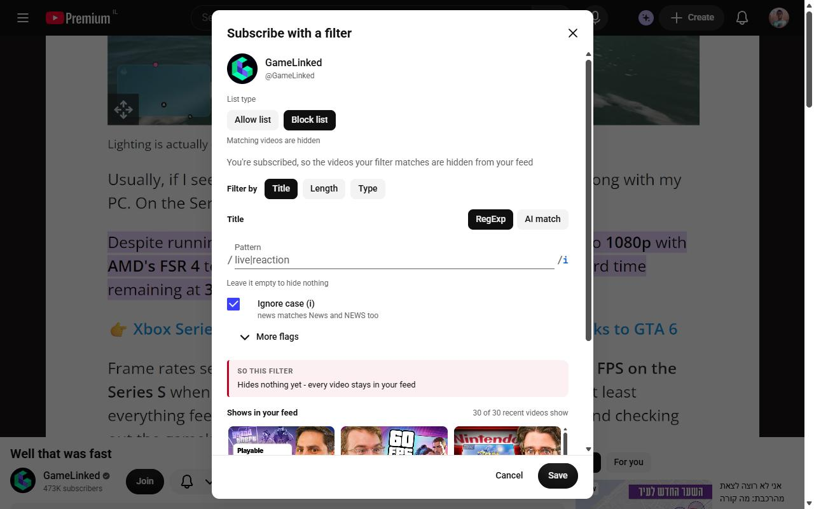

# YouTube Semi-Subscribe

Follow a YouTube channel without getting all of it, or subscribe and leave out the parts you don't want. A button sits next to YouTube's own Subscribe button, and each channel gets one of two modes, depending on whether you're subscribed:

- **Follow without subscribing** - pick a filter, and only that channel's videos that pass it show up in your subscriptions feed
- **Subscribe with a filter** - you're subscribed, so YouTube keeps recommending the channel, and the videos your filter matches are hidden from your subscriptions feed

Works on `www.youtube.com` and `m.youtube.com`, in Chromium browsers (Chrome, Edge, Opera) and Firefox.



## Installation

\
\


Or install it by hand: open the [Releases page](https://github.com/avi12/youtube-semi-sub/releases/latest) and download the latest file for your browser.

**Chrome / Edge / Opera / Brave / Vivaldi**

1. Download `youtube-semi-sub-*-chrome.zip`
2. Open `chrome://extensions` (or `edge://extensions`, `opera://extensions`, `brave://extensions`)
3. Turn on **Developer mode** with the toggle in the top-right corner
4. Drag the zip onto the extensions page and confirm the installation

Firefox isn't published yet: Firefox only installs signed extensions, so for now run it from source with `bun run dev:firefox`.

## Features

- **A button on every channel** - always "Semi-subscribe": on one you aren't subscribed to it adds videos, on one you are it hides them. Subscribing or unsubscribing with YouTube's own button switches the mode; both filters are kept
- **Two kinds of filter**
  - **RegExp** - matched against each video's title, e.g. `/tutorial|deep dive/i`
  - **AI match** - describe what you want in plain words ("only phone reviews, not unboxings"), and a model on your device judges each video's title and description
- **Live preview** - while you edit a filter, you see which recent videos will be added to your feed, or hidden from it
- **Animated feed changes** - matching videos slide into `/feed/subscriptions` in their place by upload time, matching Shorts join the feed's Shorts shelf when it has one, and hidden videos slide out of both
- **Manage from anywhere** - the channel button, the Subscriptions section of the YouTube sidebar, `/feed/channels`, or the extension's popup

## AI match

AI match is off until you turn it on in the popup. Until then nothing AI runs and nothing is downloaded.

When it's on, the extension checks what your browser offers:

1. **Built-in AI** (the Prompt API, e.g. Gemini Nano in Chrome) when the browser has it
2. Otherwise **LiteRT-LM** running Gemma on your GPU through WebGPU. The model is downloaded once (about 1.9 GB) from Hugging Face and deleted when you turn AI match off

Either way, judging happens on your device: video titles and descriptions are never sent to a server. Each verdict is remembered per filter and video, so a video is judged once.

LiteRT-LM needs WebGPU, WebAssembly JSPI and relaxed SIMD: Chromium 137+ or Firefox 153+.

## Works with YouTube Auto Feed

If you also use [YouTube Auto Feed](https://github.com/avi12/youtube-auto-feed), the two cooperate: semi-subscribed videos are added to the feed data Auto Feed reads, so it keeps them and animates them like any other new video. Semi-subscribed Shorts join its Shorts shelf too, and hidden videos leave it, once your Auto Feed version supports it.

## Privacy

- The extension fetches the public RSS feed of each channel you follow, and of each subscribed channel whose filter hides something, from `youtube.com` every 15 minutes - falling back to the channel's Videos page when RSS is down
- Your semi-subscriptions and filters stay in your browser's extension storage
- No analytics, no accounts, no servers of its own

## Development

Requires [Bun](https://bun.com) 1.4.5, [Node](https://nodejs.org) and, for the dev server, [Rust](https://rustup.rs).

```sh
bun install
bun run dev              # Chromium, with hot reload
bun run dev:firefox
bun run build            # or build:firefox
bun run zip              # or zip:firefox (also packs the sources)
```

Before committing, run the gates listed in [CLAUDE.md](CLAUDE.md#linting): `bun run lint`, `bun run stylelint`, `bun run svelte:check`, `bun run compile`, `bun run test` and `bun run fallow`.

Built with [WXT](https://wxt.dev), [wxt-module-layers](https://github.com/davestewart/wxt-module-layers), Svelte 5, zod and [@webext-core/messaging](https://webext-core.aklinker1.io/messaging/installation).

## License

Copyright 2026 [Avi](https://avi12.com). Licensed under the [GNU General Public License v3.0](LICENSE). Third-party notices are in [NOTICE](NOTICE).

## Support

If the extension is useful to you, you can [sponsor its development](https://github.com/sponsors/avi12) or [donate through PayPal](https://paypal.me/avi12). Bugs and ideas go in the [issues](https://github.com/avi12/youtube-semi-sub/issues); see [CONTRIBUTING.md](CONTRIBUTING.md) before opening a pull request.
